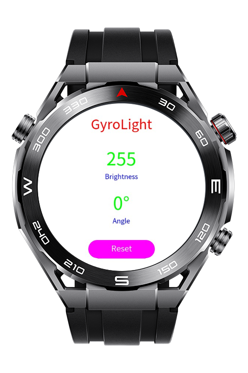

> **Note:** To access all shared projects, get information about environment setup, and view other guides, please visit [Explore-In-HMOS-Wearable Index](https://github.com/Explore-In-HMOS-Wearable/hmos-index).

# GyroLight

This application demonstrates motion-controlled screen brightness for HarmonyOS Lite Wearable devices. It uses the accelerometer sensor to detect arm tilt and dynamically adjusts the screen's background color from black to white, creating a hands-free display control experience.

# Preview
<div>
  
</div>

# Use Cases

* **Motion-Controlled Display:** Adjust screen brightness by raising or lowering your arm, useful for quick visibility adjustments without touching the screen.
* **Gesture-Based Interface:** Demonstrates natural interaction patterns for wearable devices using body motion.
* **Ambient Adaptation:** Quickly switch between dark and light display modes based on arm position.
* **Learning & Experimentation:** Developers can use this as a practical example to understand HarmonyOS Lite Wearable sensor APIs and motion-based interactions.


# Tech Stack

* **Languages:** JavaScript
* **Frameworks:** HarmonyOS SDK 5.0.0 (API 12)
* **Tools:** DevEco Studio
* **APIs:** `@system.sensor` (Accelerometer)


# Directory Structure

```
entry/src/main/
|---js/MainAbility
|   |---pages
|   |   |---index
|   |       |---index.hml          // UI layout with dynamic background
|   |       |---index.css          // Styling with contrasting text colors
|   |       |---index.js           // Sensor logic and brightness control
|---config.json                     // App configuration with sensor permissions
```


# Constraints and Restrictions

## Supported Device
  - Huawei Sport (Lite) Watch GT 4/5/6
  - Huawei Sport (Lite) GT4/5 Pro
  - Huawei Sport (Lite) Fit 3/4
  - Huawei Sport (Lite) D2
  - Huawei Sport (Lite) Ultimate

## Limitations

* Calibration resets on app restart; neutral position is set when app launches.
* Background execution not supported on Lite Wearable devices.


# License
GyroLight is distributed under the terms of the MIT License.

See the [LICENSE](/LICENSE) for more information.
